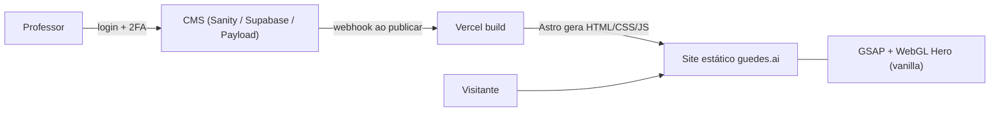

# Guedes.AI — Planejamento da V2 (pré-lançamento)

## 1. Diagnóstico do site atual (v1)

**Stack atual:** React 19 + Vite + Tailwind + framer-motion + Three.js (R3F) + postprocessing + ~28 pacotes Radix (shadcn).

**Por que está pesado** (não é "o React em si", é o que roda em cima dele):

| Causa | Onde | Impacto |
|---|---|---|
| Three.js + EffectComposer rodando shader ASCII **a cada frame**, mesmo fora da tela | [EffectScene.tsx](file:///g:/00%20-%20CLIENTES/09_GUEDES_AI/artifacts/guedes-ai/src/components/EffectScene.tsx), [AsciiEffect.tsx](file:///g:/00%20-%20CLIENTES/09_GUEDES_AI/artifacts/guedes-ai/src/components/AsciiEffect.tsx) | 🔴 Principal vilão: GPU 100% no celular, ~600 KB de JS |
| framer-motion em todas as 13 seções | todos os componentes | 🟠 ~50 KB + re-renders |
| Página inteira hidratada no cliente (SPA) | [App.tsx](file:///g:/00%20-%20CLIENTES/09_GUEDES_AI/artifacts/guedes-ai/src/App.tsx) | 🟠 Nada aparece até o JS carregar (ruim p/ SEO e LCP) |
| Dados de conteúdo hardcoded (42 KB) dentro do bundle | [Publicacoes.tsx](file:///g:/00%20-%20CLIENTES/09_GUEDES_AI/artifacts/guedes-ai/src/components/Publicacoes.tsx) | 🟡 Pesa no bundle e não é editável |
| ThemeContext (dark/light) + next-themes | `context/` | 🟡 Será removido (só light) |

**Meta de performance V2:** Lighthouse mobile ≥ 95 · JS inicial < 60 KB gz · LCP < 1,8 s · 60 fps nas animações · CPU ociosa quando nada está animando.

---

## 2. Decisões já tomadas

- ✅ Site **100% light mode** (remove ThemeContext, tokens dark e toggle).
- ✅ **Nova Hero** e **novo Footer** com fundo claro (mesmo design system).
- ✅ Animações com **GSAP + ScrollTrigger** (substitui framer-motion).
- ✅ Saída final = **HTML5 + CSS puro + JS vanilla + GSAP** (zero React no navegador).
- ✅ Seção **Conteúdo** gerenciada pelo professor, com **login + 2FA**.
- ✅ Tudo nasce em `v2/` dentro do repositório; a v1 continua intacta até o go-live.

---

## 3. Como entregar "JS puro" sem perder organização: o papel do Astro

> "astra build" = **Astro** (astro.build), entendi assim — confirme.

Astro é um **gerador**: você escreve componentes (`.astro`), e no build ele cospe **HTML + CSS + JS vanilla**. Por padrão envia **0 KB de framework** ao navegador. Ou seja: o resultado final é exatamente o que você pediu (HTML/CSS/JS/GSAP puros), mas com componentização, i18n PT/EN e integração nativa com CMS.

| | HTML puro "na mão" | **Astro (saída estática)** |
|---|---|---|
| JS no navegador | Só o seu + GSAP | Só o seu + GSAP (idêntico) |
| Componentes/reuso | Copiar e colar | ✅ Componentes |
| i18n PT/EN (já existe na v1) | Duplicar páginas manualmente | ✅ Rotas `/` e `/en` nativas |
| Puxar conteúdo de um CMS | Fetch no cliente (ruim p/ SEO) | ✅ Busca no build → HTML pronto |
| Otimização de imagens | Manual | ✅ `astro:assets` (AVIF/WebP) |

**Recomendação:** Astro como base. Os efeitos GSAP rodam em `<script>` vanilla dentro dos componentes — fluidez idêntica, sem React.

---

## 4. A Hero sem matar o celular

O efeito ASCII pode ser mantido, mas reescrito do jeito certo:

1. **WebGL puro** (um único fragment shader, ~4 KB, sem Three.js) — o ASCII é só um shader sobre a foto.
2. Renderiza **apenas quando há mudança** (mouse/scroll), não 60x por segundo parado.
3. **Pausa quando sai da tela** (`IntersectionObserver`) e quando a aba está oculta.
4. DPR limitado a 1.5, células maiores no mobile; no mobile sem mouse → animação de "revelação" única e depois congela.
5. `prefers-reduced-motion` → imagem ASCII estática pré-renderizada.
6. **Versão light:** caracteres escuros/índigo sobre fundo off-white (ex. `hsl(240 20% 98%)`).

Alternativa de risco zero: vídeo/AVIF animado pré-renderizado do efeito (perde a interação com o mouse).

---

## 5. Estudo: CMS para a seção "Conteúdo" (com 2FA)

### Requisitos
- Professor faz login com **senha + 2FA**.
- Adiciona/edita itens nas 6 categorias (Publicações, Livros & Capítulos, Prêmios, Na Mídia, Atividades Acadêmicas, Artigos de Opinião) e subcategorias.
- **Não pode quebrar o layout** → formulário com campos fixos (ano, título, veículo, link…), sem editor livre de HTML.
- Atualização aparece no site sozinha.

> [!IMPORTANT]
> O segredo de "não quebrar o layout" é o mesmo em qualquer CMS: **schema estruturado** (campos tipados e validados), não editor visual livre. O site só renderiza os campos nos cards já desenhados.

### Opção A — Astro + **Payload CMS** (sua pergunta)
**Sim, dá para usar Payload só para essa seção.**
- Payload 3 é um app Next.js separado (admin + API). Banco: **Postgres** (Supabase/Neon) ou MongoDB.
- O site Astro busca os itens via API no build; ao salvar, um webhook dispara rebuild na Vercel (~40 s).
- **2FA:** ⚠️ Payload **não tem 2FA nativo**. Precisa de plugin da comunidade (TOTP) ou integração com Better Auth → manutenção extra.
- ✅ Self-hosted, controle total, painel bonito e customizável, sem mensalidade.
- ❌ Mais infraestrutura (2 deploys + banco), é o mais complexo das opções.

### Opção B — Astro + **Sanity** (CMS gerenciado)
- Studio hospedado pela Sanity; schemas em código → campos travados.
- **2FA:** login via Google/GitHub → 2FA herdado da conta do professor (ex. Google com verificação em 2 etapas).
- ✅ Zero servidor, plano gratuito cobre fácil, preview ao vivo, muito intuitivo.
- ❌ Dados ficam na Sanity (SaaS); interface em inglês (customizável).

### Opção C — Astro + **Keystatic** (ou Decap) — CMS baseado em Git
- O conteúdo vira arquivos JSON/Markdown no próprio repositório; o painel fica em `/keystatic`.
- **2FA:** login com GitHub → 2FA do GitHub.
- ✅ Custo zero, sem banco, histórico/versão de tudo, mais simples de manter.
- ❌ Professor precisa de conta GitHub; cada publicação = commit + rebuild.

### Opção D — Vanilla/Astro + **Supabase** + mini-painel próprio
- Supabase Auth tem **MFA TOTP nativo** (Google Authenticator) + Postgres com RLS.
- Painel admin sob medida, em português, exatamente com os campos dos cards.
- ✅ 2FA nativo e robusto, UX 100% sob medida, você já usa Supabase.
- ❌ Painel precisa ser construído (estimativa 3–5 dias a mais).

### Comparativo

| Critério | A · Payload | B · Sanity | C · Keystatic | D · Supabase |
|---|---|---|---|---|
| 2FA | ⚠️ plugin | ✅ via Google/GitHub | ✅ via GitHub | ✅ **nativo TOTP** |
| Facilidade p/ o professor | ⭐⭐⭐⭐ | ⭐⭐⭐⭐⭐ | ⭐⭐⭐ | ⭐⭐⭐⭐⭐ (sob medida) |
| Infra/manutenção | Alta | Mínima | Mínima | Média |
| Custo mensal | Banco (~US$0–25) | US$0 | US$0 | US$0 (free tier) |
| Dono dos dados | Você | Sanity | Você (Git) | Você |
| Tempo de implementação | 4–6 dias | 2–3 dias | 1–2 dias | 4–6 dias |
| Escala futura (blog, newsletter, área de alunos) | ✅✅ | ✅✅ | ✅ | ✅✅ |

### Recomendação
1. **Melhor custo-benefício geral → B (Sanity)**: mais rápido, mais intuitivo, 2FA pela conta Google.
2. **Se 2FA próprio e dados sob seu controle forem obrigatórios → D (Supabase)**.
3. **Payload** só compensa se houver plano de crescer para algo maior (blog, área logada, cursos); para uma única seção é infraestrutura demais.

---

## 6. Arquitetura proposta (V2)



## 7. Estrutura de pastas `v2/`

```
v2/
├─ docs/                 # este planejamento, decisões, checklist
├─ site/                 # Astro (saída estática)
│  ├─ src/
│  │  ├─ styles/         # tokens.css (design system light), base.css
│  │  ├─ components/     # Nav, Hero, Bio, Trajetoria, Palestras, ... Footer
│  │  ├─ scripts/        # gsap-init.js, hero-ascii.js (WebGL), nav.js
│  │  ├─ i18n/           # pt.json / en.json (migrado da v1)
│  │  └─ pages/          # index.astro, en/index.astro
│  └─ public/            # imagens otimizadas, fontes
└─ cms/                  # (opção A/D) admin ou schemas (opção B)
```

---

## 8. Sequência de ações

### Fase 0 — Decisão
- [x] Escolher CMS: **Sanity**
- [x] Confirmar gerador: **Astro (saída estática HTML5 + CSS puro + GSAP + WebGL leve)**
- [x] Aprovar direção visual da Hero e Footer light (mockups gerados e aprovados)

### Fase 1 — Fundação
- [x] Criar projeto Astro em `v2/site`
- [x] Portar design system para CSS puro (`global.css`) 100% light mode (sem Tailwind, sem runtime React)
- [x] Fontes variáveis (GeistSans, GeistMono, GeistPixel) com `font-display: swap`
- [x] Setup GSAP + ScrollTrigger para animações de entrada suaves com `[data-reveal]`

### Fase 2 — Design Light
- [x] Nova Hero clara com shader ASCII em WebGL sob demanda (0% GPU parado, pausa fora da tela)
- [x] Novo Footer claro com formulário de contato, foto do professor, wordmark pixelado e rodapé com copyright
- [x] Revisão de contrastes e paleta refinada (off-white, tinta escura, índigo e violeta)

### Fase 3 — Migração das seções
- [x] Nav (Navbar responsiva, seletor PT/EN e menu mobile animado com GSAP)
- [x] Hero (WebGL vanilla sob demanda com fallback)
- [x] Clientes (Marquee infinito acelerado por GPU em CSS puro)
- [x] Bio (Biografia, tags e modal HTML5 nativo `<dialog>` com bio completa)
- [x] Palestras (Cards detalhados com grids e contrastes adaptados)
- [x] Trajetória (Timeline horizontal fluida no desktop e vertical no mobile)
- [x] Publicações / Conteúdo (6 abas completas com sub-abas, tabelas e visualização expansível)
- [x] Soluções (Grid de serviços)
- [x] Depoimentos (Carrossel com scroll-snap nativo e links para LinkedIn)
- [x] Newsletter (Chamada para o LinkedIn)
- [x] Contato e Footer (Integrados com validação de formulário)
- [x] WhatsApp Button (FAB flutuante)
- [x] Suporte multilíngue PT e EN (`/` e `/en/`)

### Fase 4 — CMS da seção Conteúdo
- [x] Modelar schemas do Sanity em `v2/cms/schemas.ts`
- [x] Isolar dataset estruturado em `v2/site/src/data/publicacoes.ts`
- [x] Documentar configuração do Sanity Studio e 2FA Google em `v2/cms/README_SANITY.md`
- [ ] Conectar API Sanity ao build Astro (após criação do `projectId` pelo cliente)

### Fase 5 — QA e performance
- [x] Validação de build estático (Astro gera `/index.html` e `/en/index.html` em 400ms)
- [ ] Teste ao vivo em celular e desktop
- [ ] Apontamento e deploy de preview na Vercel

### Fase 6 — Go-live
- [ ] Deploy v2 em preview Vercel → aprovação → apontar domínio
- [ ] Manter v1 como fallback por 2 semanas

**Estimativa total:** ~10–16 dias úteis, dependendo do CMS escolhido.

---

## 9. Perguntas em aberto
1. Qual CMS? (minha sugestão: **Sanity** ou **Supabase** se 2FA próprio for exigência)
2. O professor tem conta Google com verificação em 2 etapas? (viabiliza a opção B)
3. Manter PT/EN na v2?
4. Manter o efeito ASCII interativo na Hero light ou partir para outro conceito?
5. Domínio final já definido (guedes.ai)?
